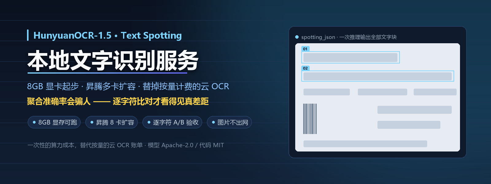
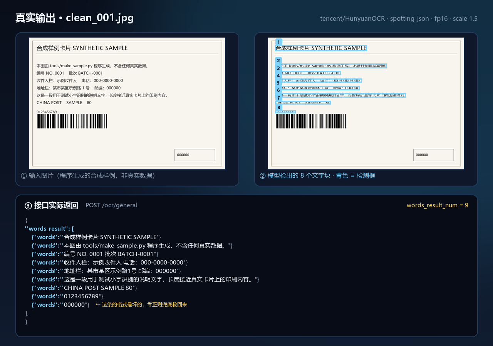

<div align="center">
  
</div>

<div align="center">

# HunyuanOCR 本地文字识别服务

**用 HunyuanOCR-1.5 在自有算力上做中文文字识别，把按量计费的云 OCR 换成自己的一张显卡。**

> Local Chinese text spotting on your own GPU or Ascend NPU — free, private, and character-level verifiable.

[](LICENSE)
[](https://www.python.org/)
[](https://huggingface.co/tencent/HunyuanOCR)
[](docs/%E9%83%A8%E7%BD%B2%E8%AF%B4%E6%98%8E.md)
[](https://github.com/hhprince/HunyuanOCR-Local-Text-Spotting-Service)

[实际效果](#实际效果) · [60 秒跑通](#60-秒跑通) · [方案对比](#和别的方案比) · [实测数据](docs/实验记录.md) · [部署说明](docs/部署说明.md)

</div>

---

> **本项目的一部分实测数据已发布到官方仓库的讨论中**：
> [Tencent-Hunyuan/HunyuanOCR#114](https://github.com/Tencent-Hunyuan/HunyuanOCR/issues/114#issuecomment-6432419874)
> —— 关于 processor 像素上限、放大倍数的代价，以及 bf16 / fp16 逐字符差异的 CUDA 侧实测。

## 实际效果

<div align="center">
  
</div>

左边是输入，右边是模型**真实检出**的文字块，下面是接口**实际返回**的 JSON。

> 这张图不是示意图。`docs/demo_raw.txt` 是模型对仓库里这张合成样例图的
> **原始输出，一个字都没改**；`tools/make_demo.py` 只负责把它画出来。
>
> 最后那条 `"000000"` 在模型原始输出里格式是坏的（少冒号少方括号），
> **靠容错解析救了回来**——这就是下面"三个必须知道的坑"第 3 条讲的事。

## 60 秒跑通

```bash
pip install -r requirements.txt
python tools/make_sample.py --style noisy --count 6 --out data/samples_noisy
python batch_ocr_dev.py --input-dir data/samples_noisy
```

需要一块 8GB 显存的 NVIDIA 显卡（没有的话用 `--device cpu` 能跑通流程，只是慢）。
模型权重首次下载约 4GB，国内建议先 `export HF_ENDPOINT=https://hf-mirror.com`。
起服务只要一条：

```bash
python serve_ocr_prod.py --host 0.0.0.0 --port 8000
curl -F 'image=@data/samples_noisy/noisy_001.jpg' http://127.0.0.1:8000/ocr/general
```

## 和别的方案比

| | 主流云 OCR | 通用开源 OCR 框架 | **本仓库** |
|---|---|---|---|
| 成本 | 按调用量计费，量越大越贵 | 免费 | 免费（自有算力，一次性投入） |
| 图片是否出网 | **是** | 否 | **否** |
| 上手成本 | 直接调 API | 要自己封装服务、攒 GPU | 一条命令起服务，接口与云 OCR 同构 |
| 换模型 / 换配置 | 不能 | 能 | 能，且开发/生产**共用一份核心** |
| 准确度怎么证明 | 拿不到逐字差异 | 得自己搭 | **自带逐字符 A/B 工具 + 可复现公开基准** |
| 自有算力多卡 | 不适用 | 看你自己 | **昇腾 NPU 多卡数据并行** |

## 为什么值得看：聚合指标会骗人

> 三档权重精度（bf16 / fp16 / fp32）的**行命中率完全相同**（都是 44/60），
> 字符准确率只差 **0.07 个百分点**。
>
> **光看这两个指标，官方默认的 bf16 和 fp16 毫无区别。**
>
> 但逐字符比，只有 **2/6** 的图片结果完全相同——4 张图的差别是
> "考察/考虑"、"权重/权限"这种**单字替换**。

聚合指标分辨不出"错了一个字"。**本仓库最想说明的就是这件事**，
所以它自带一套逐字符比对工具和一份可以复现的公开基准。

## 五步把字看清

| | 步骤 | 干什么 | 一条命令 |
|---|---|---|---|
| ① | **拉权重** | 装依赖，把 1.12B 权重拉到本地缓存 | `pip install -r requirements.txt` |
| ② | **造字纸** | 程序画出合成样例图，同时导出标准答案 | `python tools/make_sample.py --style noisy --count 6 --out data/samples_noisy` |
| ③ | **试读** | 开发机单卡跑通，产出一份结果 JSON | `python batch_ocr_dev.py --input-dir data/samples_noisy` |
| ④ | **开服务** | 起 HTTP 服务，昇腾多卡数据并行 | `python serve_ocr_prod.py --host 0.0.0.0 --port 8000` |
| ⑤ | **校对** | 逐字符 A/B + 打分，证明改动没让准确度变差 | `python tools/compare_runs.py a.json b.json --diff` |

<details>
<summary><b>展开每一步的细节</b></summary>

### ① 拉权重

```bash
python -m venv .venv && source .venv/bin/activate   # Windows: .venv\Scripts\activate
pip install -r requirements.txt
```

权重会自动从 HuggingFace 下载并缓存（约 4GB）。国内建议先设镜像：

```bash
export HF_ENDPOINT=https://hf-mirror.com
```

> **最低要求**：transformers ≥ 5.13.0（`HunYuanVL` 架构只在 5.x 提供）、显存 ≥ 8GB。

### ② 造字纸

仓库里**不含任何真实图片**，样例是 `tools/make_sample.py` 程序画出来的，
同时导出 `ground_truth.json`（合成图的标注是已知的，直接导出）：

```bash
python tools/make_sample.py --style clean --count 3 --out data/samples_clean
python tools/make_sample.py --style hard  --count 6 --out data/samples_hard
python tools/make_sample.py --style noisy --count 6 --out data/samples_noisy
```

三档风格分别对应：干净 / 小字+噪点 / 小字+噪点+低对比+强压缩（最难）。

### ③ 试读

```bash
python batch_ocr_dev.py --input-dir data/samples_noisy
```

输出 `output/ocr_<时间戳>.json`，头部带全部实际生效的参数（模型、提示词、
放大倍数、精度、采样、attn），**换环境时一眼就能看出配置有没有跑偏**。

### ④ 开服务

```bash
# 开发机调试（用 CUDA 模拟多卡）
python serve_ocr_prod.py --devices cuda:0,cuda:0 --port 8001

# 生产（昇腾 8 卡）
python serve_ocr_prod.py --host 0.0.0.0 --port 8000
```

接口与主流云 OCR 同构：`POST /ocr/general` → `{"words_result": [{"words": "..."}], "words_result_num": N}`。

### ⑤ 校对

**光比"命中项数"会骗人，必须逐字符比。**

```bash
# 跑两遍，参数不同
python batch_ocr_dev.py --input-dir 你的图 --output-dir output/a --dtype float16
python batch_ocr_dev.py --input-dir 你的图 --output-dir output/b --dtype bfloat16

# 逐字符比：几张图完全相同 + 每张图第一处不同的位置
python tools/compare_runs.py output/a/*.json output/b/*.json --diff

# 有标注就直接打分：行命中率 + 字符准确率
python tools/score.py output/a/*.json --truth 你的标注.json
```

完整的验收流程和判定阈值见 [docs/准确度验收.md](docs/准确度验收.md)。

</details>

## 三个必须知道的坑

**1. 放大倍数有硬上限，但没有通用最优值。**
processor 的 `max_pixels = 2048² = 4.19MP`，超了会被内部缩回去：

| scale | 进模型的像素 | 行命中率 | 说明 |
|---|---|---|---|
| 1.0 | 1166×784 | 46/60 (76.7%) | 合成图上最好 |
| 1.5 | 1736×1176 | 44/60 (73.3%) | 默认值 |
| 2.5 | 2492×1652 | 37/60 (61.7%) | **超限被缩回**，双重重采样把笔画糊掉 |

> **显存大不是调大 scale 的通行证**，瓶颈在重采样不在显存。
> 临界点 = 4.19MP / 原始像素数。

但 1.0 和 1.5 谁更好**取决于你的图**：合成图本来就清晰，放大只引入插值模糊；
真实翻拍照片的原始细节比模型的 token 网格更细，放大能把细节带进去。
**所以必须用 `tools/score.py` 在自己的数据上测，不要照抄别人的默认值。**

**2. 提示词用官方的，采样反而要偏离官方。**
官方把 12 种任务的提示词锁死不让改，确实有道理——换回官方提示词后回归集上
多找出多个真实文本块，自造提示词整块漏掉。
但官方 client 默认带 `repetition_penalty=1.08`，那是给长文档防贪心重复退化用的；
本场景下同一印刷短语重复出现是正常内容，加惩罚实测会**掉真块、造出假字段名**。
这里刻意用纯贪心，准确率优先。

**3. 输出解析不能"一个坏元素毁掉整张图"。**
实测模型会吐出 `{"box755, 880, 818, 903], "text": "..."}` 这种少冒号少方括号的坏格式，
整个数组于是不是合法 JSON。原来的实现直接判"解析失败"，**整张图的块全丢**
（6 张样例里 4 张中招，clean 集准确率从 100% 掉到 33%）。
现在改成整段解析失败就退化成"逐个抠 `text` 字段"，坏的那个自动跳过——
上面那张演示图里最后一条 `"000000"` 就是这么救回来的。
见 `tools/test_parser.py` 的回归测试（10 条断言，秒级跑完，不用 GPU）。

## 适合谁 / 不适合谁

**适合**

- 图片不能出网、涉敏的识别场景（单据、证件、卡片、内部资料）
- 调用量大到云 OCR 按量计费吃不消的
- 手上已经有 NVIDIA 显卡（8GB 起）或昇腾 NPU 集群的
- 需要**说清楚**"这次改动到底有没有让准确度变差"的团队

**不适合**

- 只偶尔识别几张图、算力紧张——直接用云 OCR 更省事
- 需要版面还原（PDF 结构、表格、公式、多栏排版）——本项目做的是文字检测 + 识别，不是版面分析
- 想用托管服务开箱即用——本项目给的是可以自己部署的服务

## 架构

```
HTTP 进程（uvicorn，1 个）          ← 只做协议解析和转发
  └── N 个 worker 进程               ← 每进程 1 张卡 + 1 份模型
        req_q[i] / resp_q[i]         ← 每个 worker 一对私有队列
```

请求进来 → 挑一个空闲 worker → 投进它的队列 → 从它的队列取结果。
worker 之间零通信，挂了不影响其它卡。

模型 1.12B，fp16 权重才 2.24GB，**单卡 64GB 装得下还剩 60GB**——所以用数据并行，
不上张量并行（要拉通信组，收益是负的）。

## 目录结构

```
├── ocr_core.py             共享核心：提示词/放大倍数/精度/采样/输出解析
├── batch_ocr_dev.py        开发机入口：本地 CUDA 单卡批量
├── serve_ocr_prod.py       生产入口：常驻 HTTP 服务 + N 卡负载均衡
├── test_service.py         服务自测（进程内 TestClient，不占端口）
├── tools/
│   ├── make_sample.py      生成合成样例图（仓库里不含任何真实图片）
│   ├── make_demo.py        生成 README 演示图（真实模型输出 → 图）
│   ├── make_poster.py      生成 README 海报 / GitHub 社交预览图
│   ├── compare_runs.py     两次运行逐字符比对——准确度 A/B 工具
│   ├── score.py            用 ground truth 打准确率分
│   └── test_parser.py      输出解析器的单元测试（秒级，不用 GPU）
├── data/
│   ├── samples_clean/      合成样例（干净）
│   ├── samples_hard/       合成样例（小字+噪点）
│   ├── samples_noisy/      合成样例（最难）
│   └── expected/           黄金基准
└── docs/
    ├── 部署说明.md          昇腾/CANN 安装、参数表、验收清单、风险
    ├── 实验记录.md          全部实测数据
    ├── 准确度验收.md        怎么证明改动没让准确度变差
    ├── demo.png            README 演示图（由 tools/make_demo.py 生成）
    ├── demo_raw.txt        演示图的原始素材：模型原始输出，逐字未改
    ├── poster.png          README 海报（由 tools/make_poster.py 生成）
    └── social-preview.png  GitHub 社交预览图（同上）
```

**开发环境和生产环境共用 `ocr_core.py`**，只有入口文件不同。
这是刻意的：提示词或放大倍数在两边差一点点，开发机上的准确度实测就对生产机失效了。

## 文档

| 文档 | 内容 |
|---|---|
| [需求文档.md](需求文档.md) | 背景、目标、功能/非功能需求、接口契约、验收标准、风险 |
| [使用说明.md](使用说明.md) | 安装、运行、参数、API 示例、准确度验收流程、故障排查 |
| [docs/部署说明.md](docs/部署说明.md) | 昇腾多卡部署细节、版本矩阵、风险清单、踩坑记录 |
| [docs/实验记录.md](docs/实验记录.md) | 全部实测数字 |
| [docs/准确度验收.md](docs/准确度验收.md) | 换环境/换配置后怎么验证没变差 |

## 说明

- 仓库里的样例图是 `tools/make_sample.py` 程序画出来的，**不含任何真实数据**，
  也没有随仓库发布任何真实业务图片或识别结果。
- 公开基准是**合成**样例，能验证方法与相对关系，但**绝对准确度取决于你自己的
  数据**——务必自己测。
- 模型权重来自 [tencent/HunyuanOCR](https://huggingface.co/tencent/HunyuanOCR)，
  遵循 **Tencent Hunyuan Community License Agreement**（注意：地域上不适用于
  欧盟 / 英国 / 韩国），本仓库只包含推理封装、参数调优方法论和部署脚本，
  **不分发任何权重**。
- 昇腾多卡的生产部署只验证过逻辑（worker 池、负载均衡、HTTP 层），
  **NPU 侧的算子兼容性没有实测**，见 [docs/部署说明.md](docs/部署说明.md) 的风险清单。

## English

**HunyuanOCR local text spotting service** — run Tencent's HunyuanOCR-1.5 (1.12B) for
Chinese text spotting on your own hardware: a single 8GB NVIDIA GPU for development,
multi-card Ascend NPU data parallelism in production, and an HTTP API shaped like the
common cloud OCR endpoints.

- **Private by design** — images never leave your machine.
- **Character-level accuracy A/B** — aggregate metrics hide single-character errors.
  `tools/compare_runs.py` diffs two runs character by character; `tools/score.py`
  scores against your own ground truth.
- **Reproducible baseline** — sample images and ground truth are generated by
  `tools/make_sample.py`; every measured number is in
  [docs/实验记录.md](docs/实验记录.md).
- **One core for dev and prod** — `ocr_core.py` is shared, so a prompt change on the
  dev machine cannot silently diverge from production.

Keywords: HunyuanOCR, Chinese OCR, text spotting, local OCR, private OCR, offline OCR,
OCR API, Ascend NPU, CANN, torch_npu, VLM, transformers, PyTorch.

## ⭐

如果这套"逐字符验收"的方法对你有用，点个 Star 让更多人看到。
有问题欢迎开 issue —— **附上 `tools/compare_runs.py` 的输出**会快很多。

## License

本仓库代码 MIT，见 [LICENSE](LICENSE)。
模型权重遵循腾讯 HunyuanOCR 原仓库的
**Tencent Hunyuan Community License Agreement**（地域上不适用于欧盟 / 英国 / 韩国），
本仓库不重新分发任何权重。
